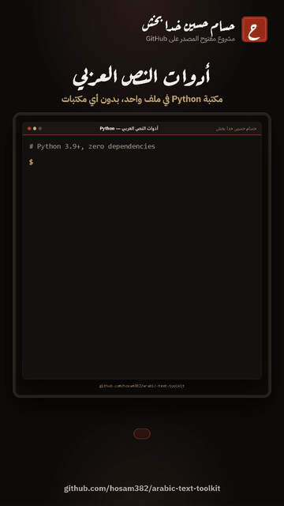

# أدوات النص العربي | Arabic Text Toolkit
**By [Hassam Hussain Khada Bakhsa](https://github.com/hosam382)**



[شاهد فيديو الشرح كامل مع الموسيقى (MP4)](demo.mp4)

## وش هي؟

مكتبة بايثون صغيرة في ملف واحد (`arabic_text.py`) تنظّف النص العربي وتقيسه:

- تحذف التشكيل (الحركات، الشدة، السكون، التنوين، علامات المصحف) والتطويل «ـ».
- توحّد أشكال الحروف: أ إ آ ٱ إلى ا، وإذا تبي: ى إلى ي، ة إلى ه، ؤ إلى و، ئ إلى ي.
- تحوّل الأرقام بين ٠١٢٣ و 0123 (وتفهم الأرقام الفارسية ۱۲۳ والفواصل ٫ ٬).
- تعدّ الكلمات، تحسب نسبة الحروف العربية، وتقدّر وقت القراءة.
- تسوي رابط (slug) نظيف من أي عنوان عربي أو مختلط.

ملف واحد، بدون أي مكتبة خارجية، يشتغل على Python 3.9 وأحدث، ومعه أداة سطر أوامر جاهزة.
الكود مكتوب بشكل واضح عشان تقدر تتعلم منه: كل دالة صغيرة ولها شرح وأمثلة.

## التثبيت

ما يحتاج `pip` ولا أي شي. نزّل الملف `arabic_text.py` وحطه في نفس مجلد مشروعك، وبعدها:

```python
import arabic_text
```

## أمثلة بالكود

```python
from arabic_text import (
    normalize, remove_tashkeel, to_latin_digits, to_arabic_digits,
    slugify, count_words, arabic_ratio, reading_time, strip_non_arabic,
)

print(remove_tashkeel("مُحَمَّدٌ"))                 # محمد
print(normalize("أَهْلًا وَسَهْلًا بِكُمْ"))         # اهلا وسهلا بكم
print(normalize("مستشفى المدينة", ya=True, ta_marbuta=True))  # مستشفي المدينه
print(to_latin_digits("السعر ١٬٢٥٠٫٧٥ ريال"))      # السعر 1,250.75 ريال
print(to_arabic_digits("الصف 2"))                  # الصف ٢
print(slugify("مرحبا بالعالم!"))                   # مرحبا-بالعالم
print(count_words("السلام عليكم ورحمة الله"))      # 4
print(arabic_ratio("Python بايثون"))               # 0.5
print(reading_time("كلمة " * 400))                 # 3
print(strip_non_arabic("Hello مرحبا World 2026!"))  # مرحبا 2026
```

مثال عملي: البحث بدون ما يفرق التشكيل أو شكل الألف:

```python
from arabic_text import normalize

names = ["أحمد", "إبراهيم", "آمنة", "مُحَمَّد"]
query = "احمد"
found = [name for name in names if normalize(name) == normalize(query)]
print(found)  # ['أحمد']
```

## أمثلة سطر الأوامر

```text
$ python arabic_text.py normalize "أَهْلًا وَسَهْلًا بِكُمْ"
اهلا وسهلا بكم

$ python arabic_text.py slug "دليل Python للمبتدئين ٢٠٢٦"
دليل-python-للمبتدئين-2026

$ python arabic_text.py ratio "أحب البرمجة بلغة Python"
0.70
```

| الأمر | وش يسوي |
| --- | --- |
| `normalize` | يوحّد الحروف ويحذف التشكيل والتطويل (خيارات: `--ya` `--ta-marbuta` `--hamza` `--digits latin`) |
| `tashkeel` | يحذف التشكيل بس |
| `digits-latin` | ٠-٩ إلى 0-9 |
| `digits-arabic` | 0-9 إلى ٠-٩ |
| `slug` | رابط نظيف |
| `count` | عدد الكلمات |
| `ratio` | نسبة الحروف العربية من 0.00 إلى 1.00 |
| `reading-time` | وقت القراءة بالدقائق (`--wpm` لسرعة القراءة) |

- اكتب `-` بدل النص عشان يقرأ من الإدخال (stdin)، مثلًا من ملف: `python arabic_text.py count - < article.txt`
- `python arabic_text.py --help` يعرض كل الأوامر.
- أمثلة أكثر مع النواتج الحقيقية في [examples.md](examples.md).

ملاحظة لـ Windows PowerShell 5.1: لو مررت نص عربي بـ `|` وطلع لك `?` بدل الحروف، شغّل هذا السطر مرة وحدة قبل:

```powershell
$OutputEncoding = [Console]::OutputEncoding = [Text.Encoding]::UTF8
```

## تشغيل الاختبارات

الاختبارات تستخدم `unittest` اللي يجي مع بايثون، فما تحتاج تثبّت شي. من داخل المجلد:

```text
python -m unittest -v
```

فيه 59 اختبار، وفوقها تتشيّك أمثلة `>>>` المكتوبة داخل الشرح في `arabic_text.py`.

---

## English

**Arabic Text Toolkit** is a single-file, zero-dependency Python 3.9+ module for cleaning and measuring Arabic text, with a small command-line tool. Download `arabic_text.py`, put it next to your code, and `import arabic_text`. Run the tests with `python -m unittest -v`.

| Function | What it does | Example |
| --- | --- | --- |
| `remove_tashkeel(text)` | Removes harakat, shadda, sukun, tanween, superscript alef (U+0670) and Quranic marks (U+0610-U+061A, U+06D6-U+06ED) | `"مُحَمَّدٌ"` -> `"محمد"` |
| `remove_tatweel(text)` | Removes tatweel (U+0640) | `"مـــرحبا"` -> `"مرحبا"` |
| `normalize(text, *, alef=True, ya=False, ta_marbuta=False, hamza=False, tashkeel=True, tatweel=True, digits=None)` | Unifies spellings: أ إ آ ٱ -> ا, ى -> ي, ة -> ه, ؤ -> و, ئ -> ي; `digits` can be `"latin"` or `"arabic"` | `"إِسْلَام"` -> `"اسلام"` |
| `to_latin_digits(text)` | ٠-٩ and ۰-۹ -> 0-9, ٫ -> `.`, ٬ -> `,` | `"١٬٢٥٠٫٥"` -> `"1,250.5"` |
| `to_arabic_digits(text)` | 0-9 (and ۰-۹) -> ٠-٩ | `"2026"` -> `"٢٠٢٦"` |
| `is_arabic(char)` | True for one Arabic-script letter | `is_arabic("ب")` -> `True` |
| `arabic_ratio(text)` | Share of letters that are Arabic, 0.0 to 1.0 | `"Python بايثون"` -> `0.5` |
| `count_words(text)` | Words with at least one letter or digit | `"مرحبا ، كيف حالك ؟"` -> `3` |
| `slugify(text)` | URL slug: Arabic + lowercase Latin + digits joined by `-` | `"مرحبا بالعالم!"` -> `"مرحبا-بالعالم"` |
| `strip_non_arabic(text, keep_spaces=True, keep_digits=True)` | Keeps Arabic letters (with tashkeel), optional digits and spaces | `"Hello مرحبا 2026!"` -> `"مرحبا 2026"` |
| `reading_time(text, wpm=180)` | Minutes, rounded up; at least 1 when there are words, 0 when there are none | `"كلمة " * 400` -> `3` |

CLI: `python arabic_text.py {normalize,tashkeel,digits-latin,digits-arabic,slug,count,ratio,reading-time} "<text>"`, or `-` to read standard input. Output is always UTF-8, so Arabic prints correctly on Windows consoles too.

---

بُني بمساعدة الذكاء الاصطناعي (Claude) وراجعه حسام

Built with AI assistance (Claude), reviewed by Hassam.

## License

MIT, see [LICENSE](LICENSE).
